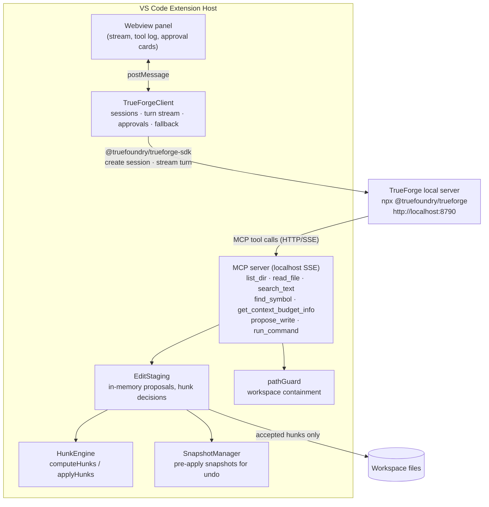
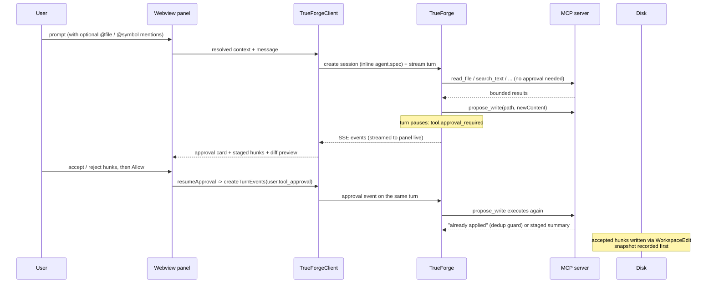

# ForgePilot

ForgePilot is a coding-agent extension for VS Code whose agent loop runs entirely on
[TrueForge](https://github.com/truefoundry/trueforge) local mode. The extension is a
thin client: it creates sessions, streams turns, hosts an MCP server that exposes
editor capabilities to the agent, and gates every file write behind a per-hunk
diff review.

Built from scratch for the TrueForge Forge-a-thon (Round 1). Licensed under MIT.

## Features

- **Agent mode** — a sidebar panel where one prompt can discover and edit multiple
  files. The agent reads code through MCP tools (`list_dir`, `read_file`,
  `search_text`, `find_symbol`) with hard output caps.
- **Inline edit** — `Ctrl+K Ctrl+I` (macOS: `Cmd+K Cmd+I`) on a selection sends the
  selected region plus an instruction to a restricted agent session.
- **Approval-gated writes** — `propose_write` and `run_command` are flagged
  destructive, so TrueForge pauses the turn with `tool.approval_required`. The
  extension stages the proposal in memory, computes unified-diff hunks, and only
  applies the hunks the user accepts — via `vscode.WorkspaceEdit`, so native
  `Ctrl+Z` works.
- **Per-hunk review** — accept/reject individual hunks in the webview or through
  CodeLens (`Accept Hunk` / `Reject Hunk`) in the editor gutter.
- **Undo** — `ForgePilot: Undo Last Applied Change` restores a snapshot taken
  before every applied edit.
- **Context engineering** — `@file:` and `@symbol:` mentions resolve to bounded
  line ranges, a configurable token budget (default 30k) is tracked per turn, and
  the agent is instructed to post a "Context chosen" rationale before editing.
  Deferred MCP tool loading (`preloadTools`) keeps rarely used tools out of the
  prompt.
- **Streaming, cancel, resilience** — tokens stream live into the panel, Cancel
  aborts the HTTP stream and drops staged proposals, and on primary-model failure
  the client retries with backoff and then replays the request on a fallback
  model in a fresh session.

## Architecture



The agent loop — model calls, tool dispatch, approval pauses, subagent threads —
lives inside TrueForge. The extension never talks to a model provider directly.

## How a turn flows



Cancel at any point aborts the stream, clears staged proposals, and leaves the
workspace untouched — writes only ever happen after explicit per-hunk approval.

## Repository layout

```
src/
  extension.ts               activation: MCP server, client, commands, CodeLens
  trueforge/client.ts        session/turn streaming, approval resume, fallback
  mcp/server.ts              in-process SSE MCP server (dynamic port)
  mcp/tools/                 list_dir, read_file, search_text, find_symbol,
                             get_context_budget_info, propose_write, run_command
  mcp/tools/pathGuard.ts     workspace containment for all file paths
  edit/staging.ts            in-memory proposals, hunk decisions, recent-apply log
  edit/hunks.ts              unified-diff hunk compute/apply
  edit/apply.ts              apply via vscode.WorkspaceEdit (editor undo stack)
  edit/snapshot.ts           pre-apply snapshots for ForgePilot undo
  edit/codelens.ts           per-hunk Accept/Reject in the editor gutter
  context/mentions.ts        @file / @symbol parsing and budget accounting
  ui/panel.ts                webview view provider, approval + tool-log bridge
  commands/                  inlineEdit (Ctrl+K Ctrl+I), undoLastChange
webview/                     panel UI (plain TS + CSS, no framework)
agent/forgepilot.agent.json  agent definition shipped with the repo
config/models.example.yaml   model configuration example (no secrets)
test/                        vitest suites: unit, MCP e2e, mock-SSE TrueForge e2e,
                            security/traversal, edit pipeline
scripts/                     probe-trueforge.ts, verify-task-a/b.ts
```

## Prerequisites

- Node.js >= 22.14
- VS Code >= 1.93.0
- Python >= 3.10 (only for the Flask demo tasks)

## Setup

1. Install dependencies and build:

   ```bash
   npm install
   npm run build
   ```

2. Start TrueForge local mode in a separate terminal:

   ```bash
   npx @truefoundry/trueforge@latest
   ```

   The server listens on `http://localhost:8790` with local SQLite storage and no
   auth.

3. Configure models in the TrueForge UI (`http://localhost:8790` → Settings →
   Models). You need a primary and a fallback model; see
   [config/models.example.yaml](config/models.example.yaml) for the expected
   shape. No API keys are stored in this repository.

4. Open this folder in VS Code and press **F5** to launch the Extension
   Development Host. On activation ForgePilot starts its MCP server on a random
   localhost port and registers it with TrueForge automatically.

5. For the demo tasks, clone Flask 3.1.3 (`git clone --branch 3.1.3
   https://github.com/pallets/flask`) in a second window, create a venv, and run
   `pip install -e . pytest`.

## Configuration

VS Code settings (`forgepilot.*`):

| Setting | Default | Purpose |
| --- | --- | --- |
| `forgepilot.serverUrl` | `http://localhost:8790` | TrueForge base URL |
| `forgepilot.primaryModel` | catalog model name | Primary model configured in TrueForge |
| `forgepilot.fallbackModel` | catalog model name | Fallback model for resilience |
| `forgepilot.tokenBudget` | `30000` | Retrieved-context token budget per turn |

## Demo tasks

**Task A — inline edit.** Open `src/flask/helpers.py`, select `get_debug_flag`,
press `Ctrl+K Ctrl+I`, and enter:

> Treat the values 'off' and 'n' as false as well, case-insensitively, and update
> the docstring to list every value that is treated as false.

Accept the hunks, then verify:

```bash
FLASK_DEBUG=off python -c "from flask.helpers import get_debug_flag; print(get_debug_flag())"
# False
```

**Task B — agent mode.** In the ForgePilot panel:

> Add a new built-in CLI command flask config that prints the loaded
> application's configuration as JSON, masking the values of any key containing
> SECRET, PASSWORD, TOKEN or KEY as "***". It must appear in flask --help, be
> covered by a test, and be documented alongside the other built-in commands.

The agent searches first, posts a "Context chosen" list, then proposes edits to
`src/flask/cli.py`, `tests/test_cli.py`, and `docs/cli.rst`. Review each file's
hunks, accept, then verify with `pytest tests/test_cli.py -q`.

**Task C — resilience.** Break the primary model endpoint/key in TrueForge
Settings, repeat Task A, and watch the client retry with backoff and replay on
the fallback model. `git status` stays clean throughout.

## Running the tests

```bash
npm test          # vitest run — unit, MCP e2e, security, edit pipeline
npm run compile   # tsc --noEmit typecheck
npm run build     # esbuild production bundle
```

The suite includes:

- `test/mcp/tools.e2e.test.ts` — a real MCP SDK client over SSE verifying the
  seven-tool surface, approval annotations, and disk-free `propose_write`.
- `test/trueforge/stream-e2e.test.ts` — a mock TrueForge server speaking the
  actual SSE protocol (snake_case events, `tool_calls[]` approval refs,
  `createTurnEvents` resume) to regression-test the approval loop.
- `test/security/` — path-traversal confinement, hostile tool inputs, MCP
  transport exposure, and audit findings.
- `test/edit/` — hunk-engine invariants and the full stage → decide → apply →
  undo pipeline.

Tests marked `it.fails` document known, unfixed issues; they keep the suite
green while flagging the flaw until it is repaired.

## End-to-end verification scripts

```bash
npx tsx scripts/probe-trueforge.ts                 # check TrueForge reachability/models
npx tsx scripts/verify-task-a.ts <flask-repo-path> # scripted Task A checks
npx tsx scripts/verify-task-b.ts <flask-repo-path> # scripted Task B checks
```

## Models and cost

Models are configured inside TrueForge, never in this repo. Development and
demo runs used catalog/free-tier models; total evaluation spend was under $1.
Declared AI assistants: Devin (Cognition) and Antigravity.

## License

MIT — see [LICENSE](LICENSE).
