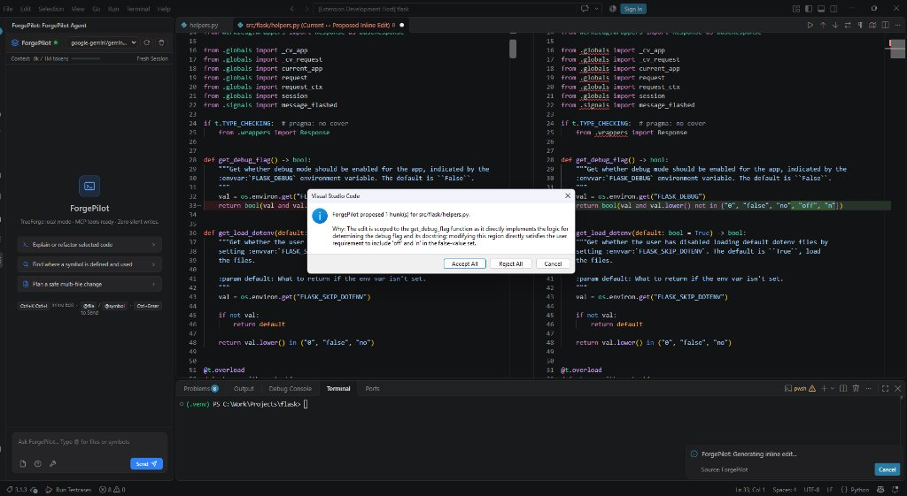
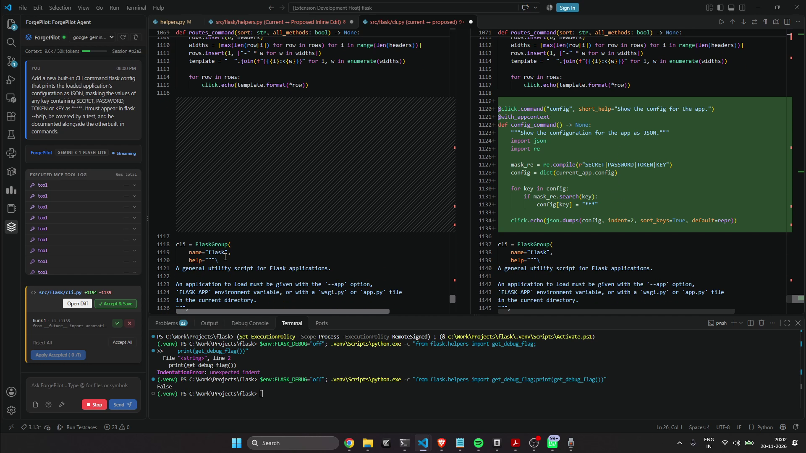
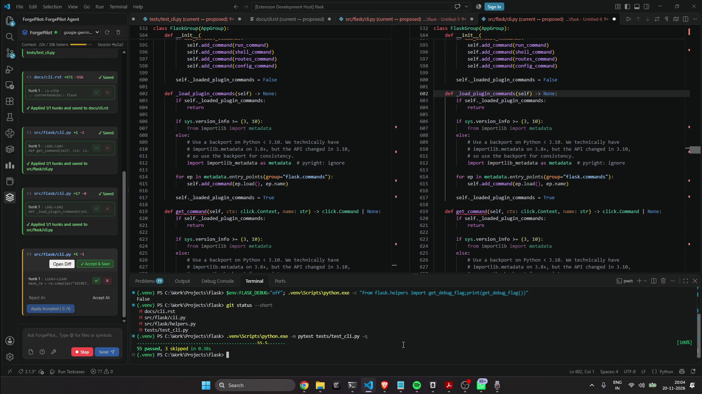
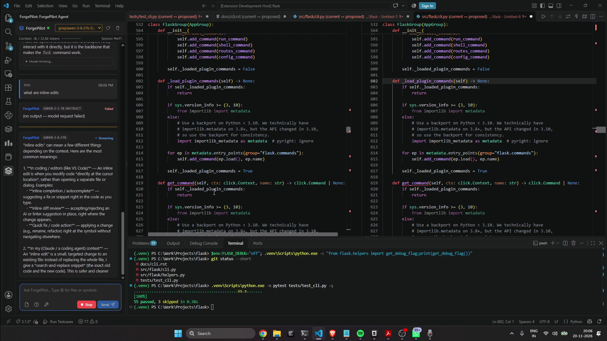
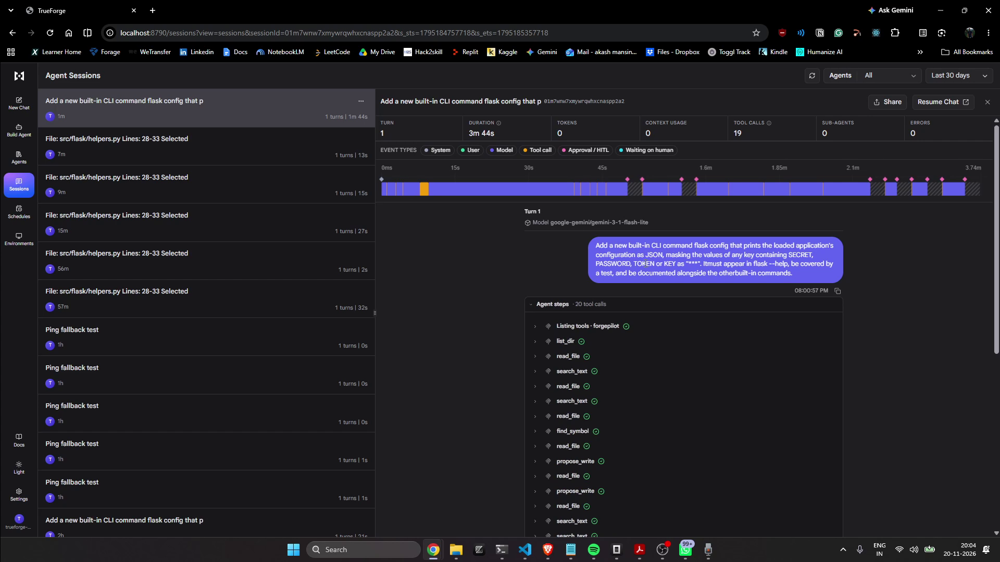
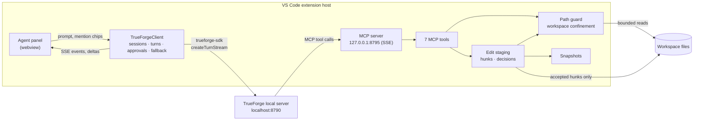
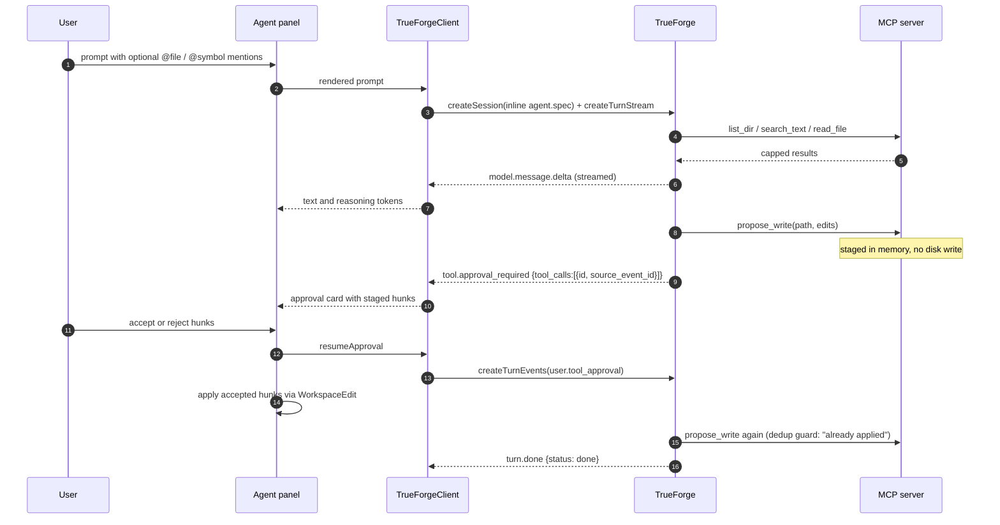
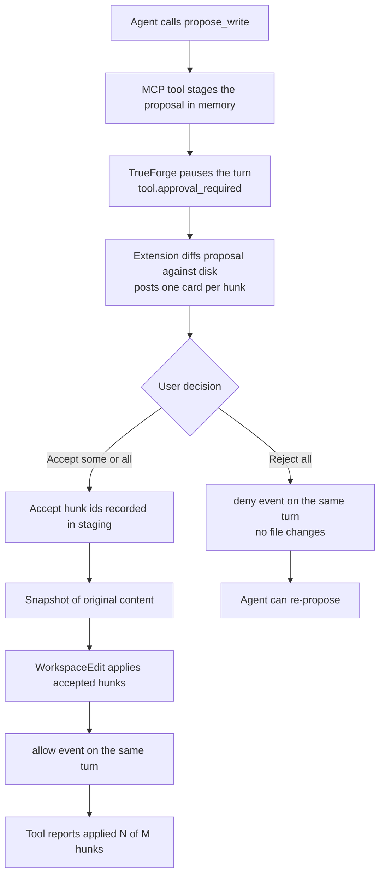
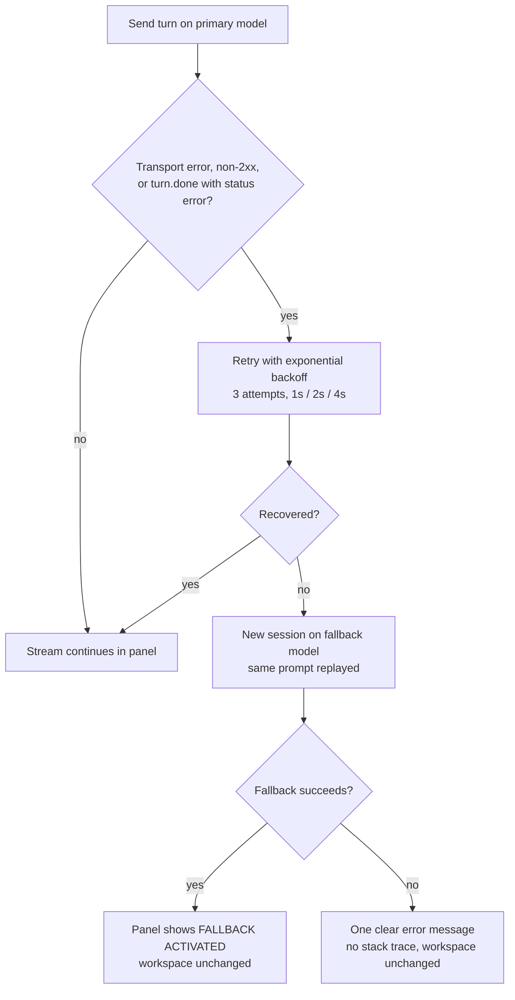
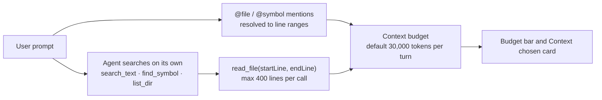

# ForgePilot

A coding-agent extension for VS Code whose agent loop runs entirely on
[TrueForge](https://github.com/truefoundry/trueforge) local mode. The extension is a
client: it creates sessions and streams turns through `@truefoundry/trueforge-sdk`,
hosts an MCP server on localhost that exposes editor capabilities to the agent, and
puts every file write behind a per-hunk diff review.

Built from scratch for the TrueForge Forge-a-thon (Round 1). MIT licensed.

| | |
| --- | --- |
| Agent loop | TrueForge local mode, `http://localhost:8790` |
| Model access | Configured inside TrueForge only. The extension has no provider SDK |
| Editor capability | Localhost MCP server, 7 tools, stdio-free SSE transport |
| Write path | `propose_write` -> TrueForge approval -> hunk review -> `WorkspaceEdit` |
| Test suite | 114 tests across 17 Vitest suites, `npm test` |

## Demo

- **Video:** [ForgePilot demo (4 min)](https://drive.google.com/file/d/1RLlnqAdQNODPK4owNfAOZgysbNhAXfoB/view?usp=drive_link)
- **Screenshots:** full-size captures in [`docs/screenshots`](docs/screenshots)

| Task A: inline edit with per-hunk review | Task B: agent run with MCP tool log |
| --- | --- |
|  |  |
| **Task B: three files changed, tests passing** | **Task C: primary failed, fallback streaming** |
|  |  |

The same turn inside TrueForge, showing the tool calls and approval prompts:



## What it does

- **Agent mode.** A sidebar panel takes one prompt and lets the agent discover files and
  edit several of them. Files are read through MCP tools with hard output caps.
- **Inline edit.** `Ctrl+K Ctrl+I` (`Cmd+K Cmd+I` on macOS) on a selection sends the
  selected range and an instruction to a restricted session.
- **Approval-gated writes.** `propose_write` and `run_command` are declared destructive
  in the agent manifest, so TrueForge pauses the turn with `tool.approval_required`.
  The extension stages the proposal in memory and shows a diff. Nothing is written until
  the user accepts specific hunks.
- **Per-hunk review.** Accept or reject each hunk in the panel or through the
  `Accept Hunk` / `Reject Hunk` CodeLens above the change in the editor.
- **Undo.** `ForgePilot: Undo Last Applied Change` restores the snapshot taken before the
  last apply. Native `Ctrl+Z` also works because writes go through `vscode.WorkspaceEdit`.
- **Context selection.** `@file` and `@symbol` mentions resolve to bounded line ranges.
  Retrieved tokens are tracked against a configurable budget (default 30,000 per turn)
  and shown in the panel.
- **Streaming and cancel.** Text and reasoning deltas stream into the panel. Cancel aborts
  the HTTP stream, drops staged proposals, and leaves the workspace unchanged.
- **Model fallback.** On a provider error the client retries with backoff, then replays the
  same prompt on the fallback model in a new session and flags it in the panel.

## Architecture



The model call, the tool dispatch, the approval pause, and the turn graph all live
inside TrueForge. The extension supplies tools and renders events. It never calls a
model provider.

### One turn, end to end



### Write safety



The MCP tool never writes. `applyProposal` is the only writer, it runs after a hunk
decision, and it refuses any path outside the workspace root.

### Model failure and fallback



### Context selection



The caps that keep retrieved code small:

| Cap | Value | Enforced in |
| --- | --- | --- |
| Lines per `read_file` call | 400 | `src/mcp/tools/readFile.ts` |
| Search hits per query | 40 | `src/mcp/tools/searchText.ts` |
| Tool output truncation marker | `[... N more lines truncated ...]` | `readFile`, `searchText` |
| Token budget per turn | 30,000 (configurable) | `src/mcp/tools/contextBudget.ts` |
| File access | workspace root only | `src/mcp/tools/pathGuard.ts` |

`get_context_budget_info` lets the agent check how much of the budget it has spent, and
the panel shows the same number from TrueForge usage data. The agent is instructed in
`agent/forgepilot.agent.json` to search before reading and to print a `Context chosen`
list with one line of reasoning per file before it edits anything.

## Repository layout

```
src/
  extension.ts                 activation: MCP server, client, commands, CodeLens
  trueforge/client.ts          sessions, turn stream, approval resume, retry, fallback
  trueforge/types.ts           streaming callback and model-info types
  mcp/server.ts                in-process SSE MCP server (port 8795, dynamic fallback)
  mcp/tools/                   list_dir, read_file, search_text, find_symbol,
                               get_context_budget_info, propose_write, run_command
  mcp/tools/pathGuard.ts       workspace containment for every file path
  edit/staging.ts              in-memory proposals, hunk decisions, dedup of applied edits
  edit/hunks.ts                unified-diff hunk computation and application
  edit/apply.ts                apply through vscode.WorkspaceEdit so undo works
  edit/snapshot.ts             pre-apply snapshots for ForgePilot: Undo Last Applied Change
  edit/codelens.ts             Accept Hunk / Reject Hunk in the editor
  context/mentions.ts          @file and @symbol parsing
  ui/panel.ts                  webview view provider, approval and tool-log bridge
  commands/inlineEdit.ts       Ctrl+K Ctrl+I flow
  commands/undo.ts             undo last applied change
webview/                       panel UI (plain TypeScript and CSS, no framework)
agent/forgepilot.agent.json    agent definition used for the demo
config/models.example.yaml     model configuration example, no secrets
test/                          17 suites: unit, MCP e2e, mock-SSE TrueForge e2e, security
scripts/                       probe, verification, and benchmark scripts
docs/                          technical write-up and screenshots
```

## Prerequisites

- Node.js 22.14 or newer
- VS Code 1.93 or newer
- Python 3.10 or newer (only for the Flask demo tasks)

## Setup from a clean clone

1. Install dependencies and build the extension bundle:

   ```bash
   npm install
   npm run compile
   npm run build
   ```

2. Start TrueForge local mode in its own terminal and leave it running:

   ```bash
   npx @truefoundry/trueforge@latest
   ```

   It listens on `http://localhost:8790`, stores state in local SQLite, and needs no auth.

3. Configure models. Open `http://localhost:8790`, go to Settings > Models, and add a
   primary and a fallback model. Either use a catalog provider or point at an
   OpenAI-compatible endpoint. `config/models.example.yaml` shows the fields that matter:
   base URL, model id, display name, context window, and max output tokens. The model must
   support tool calling; reasoning-only or completion-only models cannot drive the loop.

   The display names you choose here are the values for `forgepilot.primaryModel` and
   `forgepilot.fallbackModel`. They are `provider/model-name`, not the raw model id.

4. Open this folder in VS Code and press **F5**. On activation ForgePilot starts its MCP
   server on `127.0.0.1:8795` (random port if that one is taken) and registers it with
   TrueForge as `forgepilot`. The Output panel logs both steps.

5. Set the two model names in Settings if the defaults do not match your TrueForge catalog.
   The panel model dropdown lists what TrueForge currently reports.

6. For the demo tasks, prepare Flask in a second window:

   ```bash
   git clone --branch 3.1.3 https://github.com/pallets/flask
   cd flask
   python -m venv .venv
   .venv/Scripts/activate      # Windows
   pip install -e . pytest
   ```

## Configuration

| Setting | Default | Purpose |
| --- | --- | --- |
| `forgepilot.serverUrl` | `http://localhost:8790` | TrueForge base URL |
| `forgepilot.primaryModel` | `google-gemini/gemini-3-1-flash-lite` | Model used for new sessions |
| `forgepilot.fallbackModel` | `groq/qwen-3-8-27b` | Model replayed on primary failure |
| `forgepilot.tokenBudget` | `30000` | Retrieved-context budget per turn |

The agent definition in `agent/forgepilot.agent.json` sets the instructions, marks
`propose_write` and `run_command` as requiring approval, and keeps rarely used tools out
of the prompt with `preload: false` plus an explicit `preload_tools` list.

## Demo tasks

### Task A: inline edit

Open `src/flask/helpers.py`, select `get_debug_flag` (lines 28-33), press
`Ctrl+K Ctrl+I`, and enter:

> Treat the values 'off' and 'n' as false as well, case-insensitively, and update the
> docstring to list every value that is treated as false.

The diff opens beside the file with `Accept Hunk` and `Reject Hunk` actions. Accept both
hunks, then verify:

```bash
FLASK_DEBUG=off python -c "from flask.helpers import get_debug_flag; print(get_debug_flag())"
# False
```

The captured diff is the top-left screenshot in [Demo](#demo).

### Task B: agent mode

In the ForgePilot panel, with no files attached:

> Add a new built-in CLI command flask config that prints the loaded application's
> configuration as JSON, masking the values of any key containing SECRET, PASSWORD, TOKEN
> or KEY as "***". It must appear in flask --help, be covered by a test, and be documented
> alongside the other built-in commands.

The agent searches the tree, posts a `Context chosen` list, then proposes edits. Review and
accept the hunks per file. Verification:

```bash
git status --short        # M docs/cli.rst, M src/flask/cli.py, M tests/test_cli.py
pytest tests/test_cli.py -q
python -m flask --app <app> config
```

The run, the applied multi-file diff, and the matching TrueForge session are in
[Demo](#demo).

### Task C: fallback

Break the primary model in TrueForge Settings (wrong base URL, revoked key, or an
unloaded local model), then repeat Task A. The client retries with backoff, replays the
prompt on the fallback model, and marks it in the panel. `git status` stays clean.

## Running the tests

```bash
npm run compile   # tsc --noEmit typecheck
npm run build     # esbuild production bundle
npm test          # vitest run
```

The suite is 114 tests across 17 files. It covers:

- `test/mcp/tools.e2e.test.ts` - a real MCP SDK client over SSE against the running server,
  checking all seven tools, their approval annotations, and that `propose_write` leaves the
  disk untouched.
- `test/trueforge/stream-e2e.test.ts` - a mock TrueForge server speaking the real wire
  protocol: snake_case events, `tool_calls[]` approval references, `createTurnEvents`
  resume, delta merging, and a stream that ends without `turn.done`.
- `test/security/` - path traversal and workspace confinement, hostile tool inputs, and the
  MCP transport surface.
- `test/edit/` - hunk engine edge cases and the full stage, decide, apply, undo pipeline.

A few tests carry `it.fails`. They pin behaviour that is documented as a known limitation
in the next section, so the suite stays green until the limitation is addressed.

## End-to-end scripts

These run against a live TrueForge instance and a Flask checkout:

```bash
npx tsx scripts/probe-trueforge.ts                  # reachability, catalog, model list
npx tsx scripts/verify-task-a.ts  <flask-path>      # Task A checks
npx tsx scripts/verify-task-b.ts  <flask-path>      # Task B checks
npx tsx scripts/verify-task-c.ts  <flask-path>      # Task C fallback checks
npx tsx scripts/e2e-turn.mts '<provider/model>'     # one turn against a named model
```

## Models and cost

Everything ran through TrueForge local mode. During development the primary model was a
free-tier Gemini flash model and the fallback a Groq-hosted model; local LM Studio models
were used for early tool-calling tests. Total spend across the evaluation was below $1.

AI assistants used while building this: Devin (Cognition) for a code audit that produced
the regression tests in `test/security/`, and Antigravity for UI scaffolding.

## Known limitations

- MCP transport has no authentication. It binds `127.0.0.1` and allows any local process to
  connect. A per-session token is the next step; today the approval gate and the path guard
  are what prevent unwanted writes.
- `run_command` is approval-gated but runs with the workspace as its working directory, not
  inside a sandbox. A command can reference paths outside the workspace.
- The token budget is tracked and reported, not hard-enforced: the per-call caps on
  `read_file` and `search_text` are what bound retrieval in practice.
- Fallback replays the prompt in a new session. Earlier turns in the original session are
  not carried over.
- Deleting a file completely produces an empty file rather than removing it.

## Submission

- Repository: [github.com/theRiddler9/Forge-a-thon](https://github.com/theRiddler9/Forge-a-thon)
- Technical write-up: [docs/WRITEUP.pdf](docs/WRITEUP.pdf)
- Demo video: [ForgePilot demo (4 min)](https://drive.google.com/file/d/1RLlnqAdQNODPK4owNfAOZgysbNhAXfoB/view?usp=drive_link)

## License

MIT. See [LICENSE](LICENSE).
